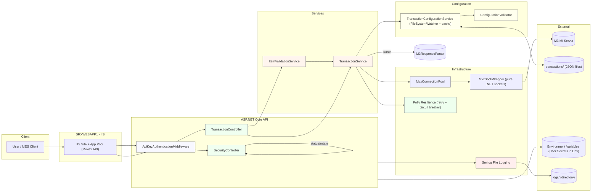

# Architecture Overview

Updated: 2026-01-12

Notes:
- ApiKeyAuthenticationMiddleware protects all routes except `/health`.
- TransactionService builds MI requests from JSON config, uses connection pool and resilience, and parses responses.
- Configuration files in `transactions/` are validated and hot-reloaded.
- Serilog writes rolling logs to `logs/`.
