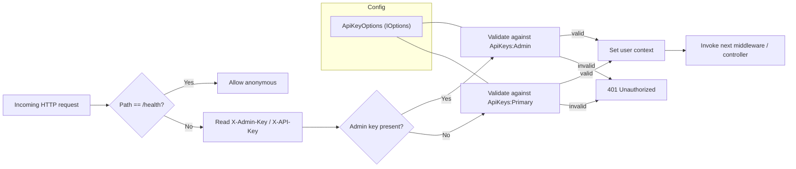

# API Key Authentication Flow

Updated: 2026-01-12

Notes:
- Admin key enables privileged operations (e.g., rotation endpoints) when exposed.
- Primary key protects application routes.
- Health endpoint is intentionally left open for monitoring.
