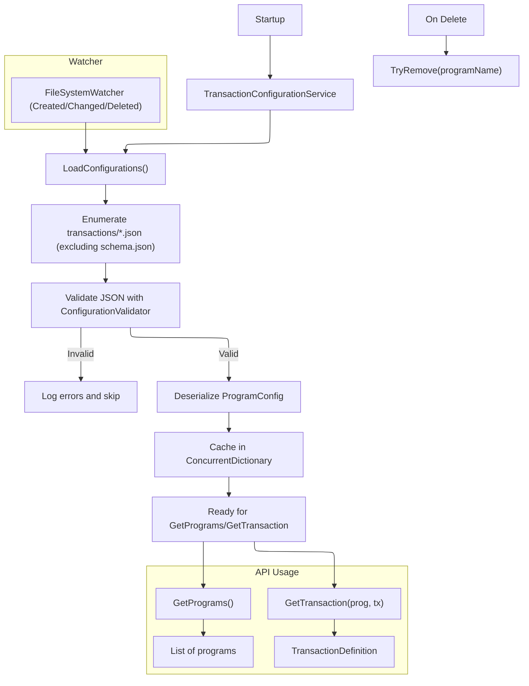

# Transaction Configuration Flow

Updated: 2026-01-12

Notes:
- Files are hot-reloaded; changes propagate without restart.
- Deleted files remove corresponding entries from the cache.
- Validator enforces required fields and valid types.
