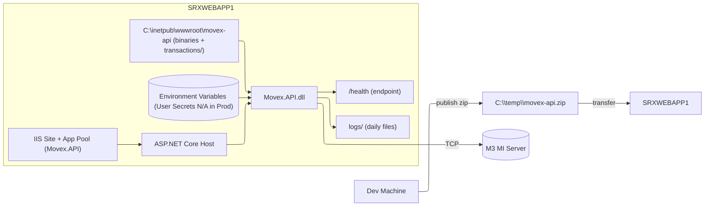

# Deployment Topology

Updated: 2026-01-12

Notes:
- Use `scripts/pre-deployment-check.ps1` and `scripts/deploy-to-iis.ps1` on SRXWEBAPP1.
- Logs stored under `logs/` with rotation and retention.
- Health endpoint exposed for monitoring.
- Swagger UI/JSON is optional in production and requires `X-API-Key` when enabled.
