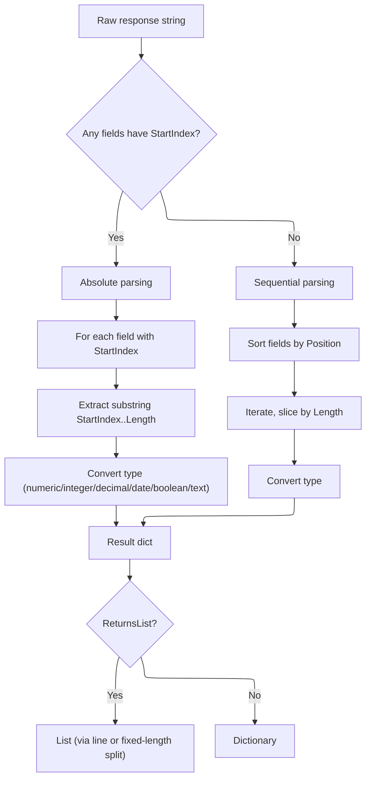

# Response Parsing Flow

Updated: 2026-01-12

Notes:
- Empty values convert to defaults: 0/false/empty string; zero-dates become null.
- Parsing is bounds-checked; out-of-range accesses log warnings and yield nulls.
- Output values are nullable to reflect missing/invalid fields gracefully.
